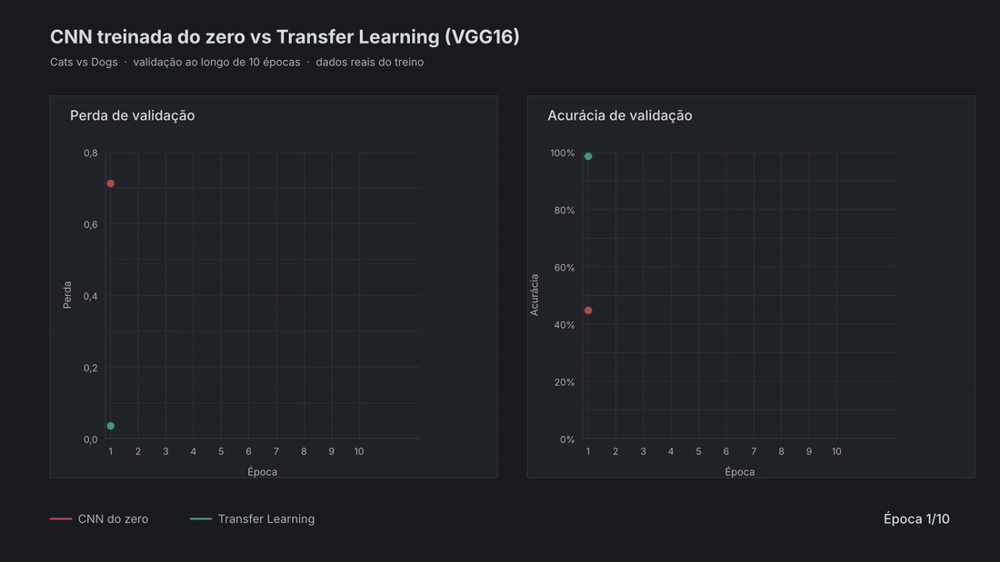

# Comparação de rede neural convolucional treinada do zero com o Transfer Learning

Tópicos

* Código e suas funções.
* Detalhes do processo.
* Resultados.

## Código e suas funções

1- São importadas as bibliotecas e instalado o que precisa.

2- Definido o dataset usado (cachorros vs gatos), com 1500 imagens de cada classe, e impresso como "Salvas 1500 imagens de gatos e 1500 de cachorros" ao final.

3- `train_split` e `val_split` são definidos para treinamento e validação, respectivamente 70% e 15% (os outros 15% são para teste).

4- A função de redimensionamento (224x224) e preparação é definida, e percorridas todas as imagens e randomizadas.

5- Então elas são divididas para suas respectivas funções (70, 15, 15, sendo 2100, 450 e 450 imagens), definidos os rótulos e convertidos em vetores (one-hot) e por fim tudo isso é impresso.

6- O modelo é montado e configurado com suas configurações e é iniciado o treinamento do zero (10 épocas), exibindo junto sua acurácia.

7- Após o treinamento do modelo base, é ilustrada a acurácia de validação com sua perda ao longo das épocas, e o `model.evaluate` testa o modelo no conjunto de teste.

8- Então é carregado o modelo de transferência de rede pré-treinada (VGG16 com pesos do ImageNet) exibindo sua arquitetura e parâmetros.

9- É feita uma nova camada (`Dense` com 2 classes) ligada à penúltima como um novo modelo, e o resto é congelado mantendo apenas essa nova camada treinável (8.194 parâmetros), sendo compilada.

10- O `model_new.fit` treina o novo modelo com a transferência de aprendizagem e o valida (10 épocas), salvando em `history2`.

11- Então são comparados os modelos lado a lado, e medidas a perda e a acurácia do novo modelo no teste.

12- Por fim é testada uma imagem (`cat_0.jpg`) e exibidas as probabilidades de cada classe.

## Detalhes do processo

1- O Colab deve estar conectado idealmente em GPU com T4, caindo de horas para minutos no tempo de execução (em um teste de execução com CPU no Colab, passou de 3 horas).

2- As épocas podem ser alteradas de acordo com o objetivo ou tempo.

3- O conjunto de dados usado é Cats vs Dogs disponível em: https://www.tensorflow.org/datasets/catalog/cats_vs_dogs

## Resultados.

1- Os dois modelos foram treinados por 10 épocas e testados nas mesmas 450 imagens.

2- A CNN do zero aprendeu pouco (perda de validação quase parada em torno de 0,69, próximo de um chute entre duas classes, e acurácia de validação subindo só de 44,7% para 56,7%), enquanto o Transfer Learning já começou com cerca de 98% de acurácia de validação na primeira época e se manteve estável.

3- Isso mostra que, com poucos dados (2100 imagens de treino), reaproveitar uma rede pré-treinada funciona muito melhor do que treinar uma do zero.

(A tabela mostra o teste; os gráficos abaixo mostram a validação ao longo das épocas.)

[▶ Assistir ao vídeo em alta qualidade](img/ml_.mp4)
